# 01 · Necker 立方体：错觉写在投影里

> 用一个约 350 行的 Metal（Apple 的 GPU 图形编程框架，macOS 内置）程序复刻
> 1832 年发现的双义图形：同一幅正交线框，大脑能在两种深度解读之间自发翻转。
> 读完本篇你能掌握正交投影的"魔法角度"、刻意去掉深度线索的渲染管线，以及
> 错觉稳定区与自由旋转的交互设计——这是整个埃舍尔系列的第一块积木。

## Background

画家要在平面上表现立体，靠的是一组深度线索（depth cue，人眼判定远近的依据）：
近大远小、遮挡关系、明暗梯度。透视画法自文艺复兴起把这组线索固化成规矩，
3D 渲染里的透视相机（perspective camera）是同一套规矩的数学版。

但深度线索给多了会出事。某些线框画去掉明暗与大小线索后，大脑无法在两种深度
解读之间做决定，知觉在两者之间来回翻转——这类图被称为双义图形（ambiguous
figure）。

1832 年瑞士晶体学家 Louis Albert Necker 描述的立方体线框是其中最著名的一幅：
同一幅画，既是"从上往下看的立方体"，也是"从下往上看的另一只"。

M.C. Escher 把这种歧义发展成完整的矛盾空间：《观景楼》（Belvedere, 1958）里
男孩手中的立方体模型，每个局部都自洽，拼在一起却是一只不可能的立方体。本
实验用真实的 3D 几何渲染出 Necker 图形，并把"歧义"本身变成可交互的东西。

## What

Necker 立方体是一种双义线框图形：正交投影（orthographic projection，没有
近大远小效果的平行投影）沿立方体体对角线观察时，近角与远角投影到同一个点，
整幅画只剩 7 个可见点——它同时是两只互为镜像的立方体的合法投影。

可以把正交投影想象成"无限远处的眼睛"：所有视线平行，近处的东西不会变大。
但和真实眼睛不同的是，它同时抹掉了"近大远小"这条最重要的深度线索——
这正是错觉的原料。



> 🌐 **交互版**：本地打开 [`images/necker.html`](images/necker.html)（仓库
> 推送 GitHub Pages 后，可改用[在线版](https://yong-huang.github.io/hands-on-apple-metal/escher/01_necker_cube/images/necker.html)）。

## When to Use

- **图形学与知觉教学**：一屏之内讲清"深度线索是什么、去掉会怎样"
- **线框插画与图标**：等距风格（isometric，各轴等比例、无近大远小）插画的正交渲染是同一套管线（rendering pipeline，GPU 把顶点数据按固定步骤变成屏幕像素的处理流程）
- **视觉实验刺激材料**：双稳态（bistable，两种解读各自都能保持稳定、知觉在两者间来回切换）知觉实验需要参数可控的歧义图形

何时不用：需要真实感遮挡与纵深判断的常规 3D 场景。那里的正解恰恰相反——透视相机 + 深度缓冲（depth buffer，一块逐像素记录"离相机最近的是谁"的显存，绘制时用它决定谁被谁挡住）。

| 方案 | 差异 | 什么时候选它 |
|:---|:---|:---|
| 透视相机 + 深度测试 | 近大远小、遮挡正确；无歧义 | 常规 3D 渲染 |
| 正交相机 + 深度测试 | 无近大远小，但遮挡仍可判 | 工程 CAD、2.5D 游戏 |
| 轴测插画（axonometric，沿轴向投影的手工画法，等距风格是其中一种） | 手工控制线条粗细与遮挡 | 美术资产 |
| **正交相机 + 无深度线索** | 遮挡与大小线索全零，深度歧义 | 本实验：错觉演示 |

## Quick Start

前置条件：装好 Xcode Command Line Tools（`xcode-select --install`）；Metal 为系统自带。

```bash
./necker.sh                 # 一条龙：build → observe → clean
./necker.sh observe         # 自由旋转+滚轮缩放；F 切换解读；「重置」回魔法角度
AUTO_QUIT=6 ./necker.sh     # 6 秒自动退出（脚本化验证）
./necker.sh export out.png a   # 离屏导出 1920×1080（解读 a；b=另一种解读）
```

真实输出（全新目录执行 `AUTO_QUIT=6 ./necker.sh observe`）：

```
=====> [build] swiftc -O main.swift necker.swift（几秒钟）
编译完成 → .build/necker

=====> [observe] 运行实验（自由旋转 · 滚轮缩放 · F 切换解读；AUTO_QUIT=秒数 可自动退出）
Device: Apple M5 Pro
场景：正交线框立方体（等距角落视角，近角与远角投影重合于中心点）
[Pipeline ready] 12 条棱 + A/B 双解读面 · 错觉在魔法角度 ±5° 内稳定
拖拽：自由旋转（滚轮缩放） · F：切换深度解读 · 「重置」回魔法角度
解读 A：左下棱面在前（正常立方体）
FPS ≈ 59.3（标题栏同步显示）
FPS ≈ 60.0（标题栏同步显示）
FPS ≈ 60.0（标题栏同步显示）

实验结束。
```

真实输出（`./necker.sh export images/necker.png a`，成品见 [images/necker.png](images/necker.png)，解读 B 见 [images/necker_b.png](images/necker_b.png)）。

导出路径按运行目录解析为绝对路径，下以 `<实验目录>` 缩写；导出前还会先执行一次构建：

```
=====> [build] swiftc -O main.swift necker.swift（几秒钟）
编译完成 → .build/necker

=====> [export] 离屏渲染 1920×1080 一帧 → <实验目录>/images/necker.png（解读 a，固定视角，无窗口）
解读 A · 正交魔法角度（yaw 45° / pitch 35.26°）  尺寸 1920×1080
导出 → <实验目录>/images/necker.png
✅ PNG 已写出（51273 字节）
```

- 观察要点：外轮廓是正六边形，中心一个岔口；橙色菱形标记当前解读的"前面"。按 F，橙色从左下菱形跳到右上菱形——线框逐像素未变，但多数观者会觉得"立方体翻了个面"
- 验证方法：对导出图 `images/necker.png` 与 `necker_b.png` 做像素 diff，除高亮区外完全一致；自由拖拽旋转可看清真实结构，偏离魔法角度约 ±5° 内错觉仍成立（标题栏实时提示"错觉成立/已穿帮"）；点「重置」一键回到魔法角度与解读 A
- 诚实预期：错觉强度因人而异，部分观者几乎不感知翻转；±5° 是主观调定的稳定区，不是知觉阈值测量值；FPS 数值每次运行小幅变化

## How It Works

**魔法角度：两只立方体共享一幅投影。** 相机沿体对角线方向 `(1,1,1)/√3` 做正交观察，把每个顶点沿视线方向压平：近角 `(1,1,1)` 与远角 `(-1,-1,-1)` 与视线平行，投影后都落在画面中心——8 个角点只剩 7 个可见位置，外轮廓是正六边形，中心点向 6 个顶点发出 6 条棱。

深度歧义来自这里：给这 7 个点分配两档深度的方式恰有两组，且都自洽——一组对应"从上往下看"，另一组对应内外翻转的另一只。屏幕上没有任何像素能区分它们。

**无深度的管线：歧义是刻意保留的。** 常规管线靠深度缓冲决定遮挡；本实验的投影矩阵 z 行全零，深度缓冲从源头就不存在：

```swift
return simd_float4x4(columns: (
    SIMD4<Float>(rt.x / halfW, up.x / halfH, 0, 0),   // z 行全零：
    SIMD4<Float>(rt.y / halfW, up.y / halfH, 0, 0),   // 不写深度，就没有
    SIMD4<Float>(rt.z / halfW, up.z / halfH, 0, 0),   // "哪个在前"的答案
    SIMD4<Float>(0, 0, 0, 1)
))
```

几何数据用一个 `SIMD4<Float>` 数组打包：xyz 是顶点，w 通道当语义标签（`-1` 棱线 / `0`、`1` 两个解读面）。顶点着色器（vertex shader，GPU 上对每个顶点执行一次的小程序）按标签上色：棱线深墨色、当前解读面暖橘实色、竞争面与纸面同色（视觉上隐身）。

绘制分两次 draw 调用（每次命令 GPU 画一批顶点）：先画填充面再画棱线，棱线叠在最上层。

**F 键切换：只改一个常量。** 按键把 uniform（一次绘制中所有顶点共享、绘制期间不变的常量数据）里的解读模式在 0/1 之间翻转，顶点着色器的条件分支随之把暖橘色分配给另一个面。你在输出里看到的 `解读 A/B` 这样的打印行，就来自这次翻转。

**错觉稳定区与自由旋转。** 相机一旦偏离对角线方向，近角与远角的投影开始分离，分离超过知觉分辨率时歧义消失、立方体"塌"成明确的一只。拖拽不再夹紧在错觉区附近：自由旋转加滚轮缩放，能从任何角度看清真实结构；偏离魔法角度约 ±5° 内错觉仍成立，标题栏实时提示"错觉成立/已穿帮"，「重置」一键回到魔法角度。

## Pitfalls & Q&A

- **半透明色在 PNG 导出后变成纯白/纯黑**：直方图出现纯白与纯黑两大块。原因：半透明填充的 alpha 只有 0.38（当年的隐身面透明度），纹理读回的未预乘 RGBA 被 premultipliedLast（预乘存储，RGB 已乘 alpha）语义除以 alpha 还原，商超过 1 截断成纯白，alpha=0 则成纯黑。解法：不开混合，隐身用与纸面同色的不透明填充。
- **`magicPitch` 被类型推断成 Double**：`atan(1.0 / sqrt(2.0))` 的字面量全按 Double 参与推断，与 Float 属性混进同一个 `min/max` 表达式后编译器报 "unable to type-check in reasonable time"。解法：显式 `Float(atan(1.0 / sqrt(2.0)))`。
- **导出宽高比算错**：`Float(width / height)` 是整数除法，1920/1080 得 1，画面被拉成正方形。解法：`Float(width) / Float(height)`。
- **窗口不出现**：swiftc 直出的二进制默认无 GUI 策略，需要 `NSApp.setActivationPolicy(.regular)` 与 `activate(ignoringOtherApps:)`（同 [creative 线 01-04 实验](../../creative/)的处理）。

**Q：按 F 前后，屏幕上到底变了什么？** 只有高亮菱形从一侧换到另一侧，12 条棱的像素完全不变。翻转发生在知觉层：这正是 Necker 图形的定义——一幅画配两种等价自洽的深度解读，高亮只是提示大脑"选另一组"。

**Q：为什么不给背面的线做遮挡剔除？** 遮挡本身就是深度线索，一旦背面棱线被遮住，歧义立即消失，剩下的只是一只普通立方体。本系列后续的 Penrose 三角（项目 2）与 Belvedere 不可能立方体（项目 3）反过来利用这一点：在特定角度用真实几何"伪造"出错误遮挡。

**Q：±5° 的依据是什么？** 工程调定值，不是知觉实验结论。调法：从魔法角度逐渐增大偏离，直到近远角分离在 1080p 下肉眼可辨（约几度），再取保守整数。旋转俯仰上限由 `necker.swift` 的 `pitchLimit` 控制，缩放范围由滚动/捏合处理里的 min/max 钳制。
