# 03 · Belvedere 立方体：沿视线平移的偷梁换柱

> 用 11 条棱的立方体框架加两根互不相连的短梁，在魔法角度（错觉恰好成立的
> 观测角度）下拼出一根"下穿上不穿"的矛盾竖梁——Escher《观景楼》里那只
> 不可能立方体的实体化。
>
> 读完本篇你能掌握"沿视线平移即隐身"的投影性质、接缝断裂角（视角偏多少度接缝会裂开，
> ≈ w/2μ，w 是梁宽、μ 是短梁的平移量）的推导，以及把端头藏进视角的斜切技巧。

## Background

把深度线索（depth cue，人眼判定远近的依据）画得局部自洽、整体矛盾，就得到
不可能图形。1958 年 Escher 在《观景楼》（Belvedere）里让男孩手中捧着一只
不可能立方体：立方体正面那根竖棱，底部清楚地交叉在框架前面，顶部却分明
被框架压在后面——同一根棱，两种深度。

二维画好画，三维实物造不出：真把 12 条棱连成框架，深度关系处处唯一。实物
化的思路与 Penrose 三角（项目 2）同族——把矛盾拆到两个互不相连的零件上，
再用唯一的观测角度把它们"焊"回一体。本实验在 Metal 里造这只诈骗立方体。

## What

Belvedere 立方体实验是一种"角度依赖的错觉物体"：立方体框架去掉近侧竖棱
（剩 11 条棱），缺口感由两根短梁补齐——前梁 F 占下半段、沿视线方向向相机
平移 μ（μ 是沿视线的平移量），后梁 B 占上半段、向远处平移 μ。

正交投影（无近大远小的平行投影）下沿视线平移不改变投影，于是 F 与 B 在
画面里无缝续接成一根竖梁：底部交叉在框架前面、顶部被框架挡住——同一根梁，
两种深度，不可能成立。

可以把"沿视线平移"想象成"朝着镜头方向挪了半步"：位置真的变了，轮廓却
一丝未动。但和真正的原地不动不同的是，一旦视角偏转，挪动的距离就会以视差
形式暴露出来——这正是断口的来源。



> 🌐 **交互版**：本地打开 [`images/belvedere.html`](images/belvedere.html)（仓库
> 推送 GitHub Pages 后，可改用[在线版](https://yong-huang.github.io/hands-on-apple-metal/escher/03_belvedere_cube/images/belvedere.html)）。

## When to Use

- **装置与道具设计**：不可能立方体已被做成真实雕塑与魔术道具，原理同款
- **错觉教学**：一个物体讲清"遮挡线索 + 观测角度 + 深度平移"三件事如何合谋
- **线框插画**：立方体线框是无透视收缩（isometric，各轴等比例）插画的基本件

何时不用：需要自由视角与真实遮挡的常规 3D 场景——那里的正解是透视相机加
深度缓冲（depth buffer，逐像素记录"离相机最近的是谁"的显存）。

| 方案 | 差异 | 什么时候选它 |
|:---|:---|:---|
| 二维插画 | 画死的角度，无实物感 | 平面媒介 |
| 完整 12 棱框架 | 深度处处唯一，无矛盾 | 普通立方体展示 |
| 双短梁 + 魔法角度 | 真实存在，仅单角度闭合 | 装置、道具 |
| **正交渲染的参数化诈骗** | 平移量与断裂角全部可调 | 本实验：错觉演示 |

## Quick Start

前置条件：装好 Xcode Command Line Tools（`xcode-select --install`）；Metal 为系统自带。

```bash
./belvedere.sh                 # 一条龙：build → observe → clean
./belvedere.sh observe         # 自由旋转+滚轮缩放；偏出 ±5° 即穿帮；R 或「重置」
AUTO_QUIT=6 ./belvedere.sh     # 6 秒自动退出（脚本化验证）
./belvedere.sh export out.png open   # open=断口视角；closed=魔法角度（默认）
```

真实输出（全新目录执行 `AUTO_QUIT=6 ./belvedere.sh observe`）：

```
=====> [build] swiftc -O main.swift belvedere.swift（几秒钟）
编译完成 → .build/belvedere

=====> [observe] 运行实验（自由旋转 · 滚轮缩放 · R 重置；AUTO_QUIT=秒数 可自动退出）
Device: Apple M5 Pro
场景：11 棱框架 + 前梁 F（近）/ 后梁 B（远），接缝错位容忍 ≈ 5°
[Pipeline ready] 正交魔法角度 · 深度测试遮挡 · 自由旋转后视差揭示两根独立短梁
拖拽：自由旋转（偏出 ±5° 即穿帮，滚轮缩放） · R 或「重置」回魔法角度
FPS ≈ 59.3（标题栏同步显示）
FPS ≈ 60.0（标题栏同步显示）
FPS ≈ 60.0（标题栏同步显示）

实验结束。
```

真实输出（export 子命令，closed 视角；成品见 [images/belvedere.png](images/belvedere.png) 与 [images/belvedere_open.png](images/belvedere_open.png)）。

导出路径按运行目录解析为绝对路径，下以 `<实验目录>` 缩写；导出前还会先执行一次构建：

```
=====> [build] swiftc -O main.swift belvedere.swift（几秒钟）
编译完成 → .build/belvedere

=====> [export] 离屏渲染 1920×1080 一帧 → <实验目录>/images/belvedere.png（closed 视角，无窗口）
闭合视角（魔法角度）· 矛盾竖梁  尺寸 1920×1080
导出 → <实验目录>/images/belvedere.png
✅ PNG 已写出（54501 字节）
```

- 观察要点：魔法角度下中央竖梁上暗下亮——上段被框架横棱压住、下段压在
  框架底角上；拖过 5° 接缝裂开，45° 时两根独立短梁完全分离
- 验证方法：对比两张导出图，闭合视角只有一根竖梁，断口视角 F 悬在框架前、
  B 留在框架后；按 R 或点「重置」一键回到魔法角度
- 诚实预期：约 5° 的容忍角是 w=0.22、μ=1.4 的推论值；F 与 B 色调一亮一暗
  是刻意的深度提示，若调成同色，错觉会更"骗眼"但更难看出原理；FPS 数值
  每次运行小幅变化

## How It Works

**框架与双短梁：缺一棱、补两段。** 立方体 12 条棱去掉近侧竖棱剩 11 条，
两个 L 形角点留着等"棱"接上。前梁 F 占下半段、后梁 B 占上半段，且各自
沿视线方向平移：F 向相机挪 μ=1.4，B 向远处挪 μ=1.4。

挪动之后所有交叉都成了真实的前后关系：F 近，底部角点被它遮住；B 远，顶部
角点把它压住。矛盾还没有出现——直到两段短梁在画面里续接成同一根梁。

**沿视线平移 = 投影隐身。** 正交投影把每个点沿视线方向压平：点 p 与
p + μ·d（d 为视线方向）投影到同一像素——沿视线平移在画面里完全不可见。
于是 F 与 B 虽然在三维中分处两处，投影却与真棱逐像素重合，两段短梁在接缝
处无缝续接成一根竖梁。错觉的全部魔法就是这一次平移。

**接缝断裂角 ≈ w/2μ。** 相机偏转小角 α 时，前移与后移的两梁在接缝处相对
错开约 2μ·sinα（两倍平移量，因为一前一后）。错开超过梁宽 w，接缝裂开、
两截分离——α ≈ w/2μ。

本实验 w=0.22、μ=1.4，容忍角 ≈ 4.5°，窗口标题在偏出 5° 时提示"已穿帮"。

**同色盖板：把接缝藏进深度。** F 的顶端若垂直切断，端面会朝相机露出亮斑、
暴露接缝。解法：在 F 的顶端盖一块与后梁同色的薄板（厚 0.005）——亮斑被
压成暗色，与上方续接的后梁浑然一体，竖梁读作完整一根。

## Pitfalls & Q&A

- **竖棱在画面里是斜的**：现象是立方体像被扭歪，竖棱向一侧倾斜。原因：
  相机 up 向量（画面"竖直"的基准方向）沿用了 y-up 惯例，而本实验的竖棱沿
  世界 z 轴——up 与"竖"不共线，投影必然倾斜。解法：正交基改为 z-up（`cross(fw, (0,0,1))`，fw 为相机前向），
  竖棱投影恢复竖直。
- **矛盾梁放错了角**：现象是竖梁读作"悬在立方体中部的孤条"而非棱。原因：
  相机在 (+,+,+) 侧时，(-1,-1) 是远角——远角的梁没有"近"的资格。解法：
  矛盾梁必须放近角（(+1,+1)），且 F 前移 / B 后移的方向以相机为准。
- **接缝处露出亮斑**：现象是竖梁中段出现一小块方形亮面，接缝一眼看穿。
  原因：短梁端头垂直切断，端面法线朝向相机、被光照亮。解法：端头上盖一块
  与后梁同色的薄板，亮斑被压成暗色，与续接的后梁融为一体。

**Q：F 和 B 为什么一亮一暗？** 刻意的深度提示：亮=近、暗=远，与遮挡关系
互相印证，让"下穿上不穿"的矛盾读感更强。把两根梁调成同色，错觉会更"骗
眼"，但也更难向观众解释原理——教学场景建议保留色差。

**Q：它和埃舍尔哪幅作品同源？** 直接原型是《观景楼》（Belvedere, 1958）里的不可能立方体，数学骨架是
Necker 立方体（项目 1 的主角）。系列项目 4 会用 SDF raymarching（符号距离场光线步进：用"到最近表面的距离"函数
逐像素求出画面）复刻《上升与下降》（1960）的无限楼梯。
