# 09 · 纹理贴图：颜色来源的第三代

> 公式能画出棋盘与渐变，但画不出一张照片——真实图像的每个像素都是"数据"而非"函数"。
> 把图片数据搬上 GPU，需要两个新对象：装数据的 `MTLTexture`、定规则的 `MTLSamplerState`。
> 本实验是渲染基础篇（01-09）的收官：把一张纹理贴到中央矩形上。

## 1. 为什么需要它

顶点色（03-05）与逐像素公式（06-08）之后，颜色来源只剩最后一块拼图：**采样**。纹理把颜色从着色器逻辑中解耦——换图不换代码。这是 3D 模型、视频帧、后处理、乃至计算着色器读写数据的共同载体，`MTLTexture` 也从此成为你与 GPU 打交道频率最高的资源对象。

## 2. 总览：核心机制一图看懂



> 🌐 **交互版**：[在线打开（GitHub Pages）](https://yong-huang.github.io/hands-on-metal/metal/09_texture/images/texture.html)（或本地打开 [`images/texture.html`](images/texture.html)）。

像素数组经 `replace()` 上传成 `MTLTexture`，与 `MTLSamplerState`（linear 过滤）一起在 fragment shader 中按 uv 采样，输出贴图矩形。一句话心智模型：**纹理是数据，采样器是取数规则，uv 是取数地址**。

## 3. 快速开始

```bash
./texture.sh               # 一条龙：build → observe → clean
AUTO_QUIT=6 ./texture.sh observe   # 6 秒自动退出
```

观察要点：窗口中央一个矩形，表面是程序内生成的图案纹理（本实验不依赖外部图片，CPU 逐像素构造数据后上传，保证克隆即可跑通）。

验证方法：把采样器的过滤模式从 `linear` 换成 `nearest` 重编译——纹理放大后从平滑插值变成明显马赛克，这就是两种过滤模式的直观差异。

## 4. 核心概念

### 4.1 `MTLTexture`——GPU 上的图像容器

描述符声明像素格式（本实验 `rgba8Unorm`：每通道 8 位、0-255 归一化到 0-1）、尺寸与用途（`shaderRead`）。数据经 `replace(region:, bytesPerRow:, bytes:)` 从 CPU 数组灌入——统一内存时代这一步依然必要，因为纹理有特殊的布局/平铺优化，不是裸缓冲。

### 4.2 `MTLSamplerState`——"怎么取颜色"的规则

uv 落在纹素之间时，`linear` 用双线性插值取 4 邻均值，`nearest` 直接取最近纹素（放大后成马赛克）。uv 越界时的行为由寻址模式决定：`clamp` 锁边、`repeat` 平铺。本实验用 `linear + clamp` 的最常见组合。

### 4.3 绑定槽：CPU 与 GPU 的连接暗号

`draw(in:)` 里多了两行绑定：`setFragmentTexture(tex, index: 0)` 对应着色器 `[[texture(0)]]`，`setFragmentSamplerState(sampler, index: 0)` 对应 `[[sampler(0)]]`。**槽序号必须与着色器注解一致**——与 03 的 `[[buffer(0)]]` 同一套暗号体系，只是换了资源类型。

### 4.4 易错点

- `bytesPerRow` 忘按 64 字节对齐：`replace()` 数据错位，画面出现斜条纹。
- 纹理像素格式与 shader 返回类型不匹配（`rgba8Unorm` 采样回 `float4`），颜色会异常。
- uv 原点在**左上**而 NDC 原点在中心：贴图上下颠倒是最常见的首跑现象。

## 5. 关键 API 与字段

```swift
// 纹理描述符：尺寸 + 像素格式 + 只读用途
let desc = MTLTextureDescriptor.texture2DDescriptor(
    pixelFormat: .rgba8Unorm, width: w, height: h, mipmapped: false)
desc.usage = [.shaderRead]
let texture = device.makeTexture(descriptor: desc)!
texture.replace(region: MTLRegionMake2D(0, 0, w, h),
                mipmapLevel: 0, withBytes: pixels, bytesPerRow: w * 4)

// 采样器描述符：放大/缩小都用线性，越界锁边
let sdesc = MTLSamplerDescriptor()
sdesc.minFilter = .linear; sdesc.magFilter = .linear
sdesc.sAddressMode = .clampToEdge; sdesc.tAddressMode = .clampToEdge
```

为什么纹理要 `replace()` 而缓冲用 `makeBuffer(bytes:)`：纹理有独立的内存布局（行对齐/分块平铺），必须按布局搬运；缓冲是线性内存，可以就地构造。

## 6. 文件结构

```
09_texture/
├── README.md                          # 本文档
├── texture.sh                         # 主演示脚本：build → observe → clean（AUTO_QUIT 自动退出）
├── main.swift                         # 入口包装：调用 runTexture()
├── texture.swift                      # 实验程序本体：CPU 生成纹理 + 采样器 + 中央矩形
└── images/
    ├── texture.architecture.json      # 图源（Typed JSON IR）
    ├── texture.html                   # 交互版架构图（浏览器打开）
    └── texture.svg                    # 双主题矢量版（README 内嵌）
```

## 7. 深入要点

- **纹理与缓冲的分工？** 缓冲是线性字节数组（顶点/Uniform/计算数据）；纹理是带格式和布局的二维图像，支持按 uv 采样、硬件过滤与压缩格式。
- **过滤模式 linear/nearest 的取舍？** linear 双线性插值，放大平滑；nearest 保留像素感且省 ALU，像素风/调试用。缩小场景要 mipmap 配合。
- **寻址模式解决什么问题？** uv 越界 [0,1] 时的取值规则：clamp 锁边、repeat 平铺、mirror 镜像——平铺地面就是 repeat 一行代码。
- **绑定槽序号为什么必须严格一致？** `[[buffer(n)]]/[[texture(n)]]/[[sampler(n)]]` 是 CPU 侧 `set*Resource(index:)` 与 GPU 侧注解的唯一对应关系，错位不报错但数据送错门。

## 8. 总结

渲染基础篇（01-09）完结：设备 → 命令队列 → 三角形 → 索引 → 动画 → 三个片元实验 → 纹理。你已握住 Metal 渲染的完整主干：**数据怎么进 GPU、命令怎么提交、颜色从哪来**。剩下的 3D 变换、光照、MPS、Metal 4（见 `docs/metal.md` 路线图阶段二至六）都是在这根主干上加枝叶。

→ 转战 GPU 计算：[operator 线 · 01 向量加法算子](../../operator/01_vector_add/README.md)
