# 11 · 光照立方体：漫反射与环境光

> 立方体转起来了，但六个面颜色恒定——没有明暗，立体感是假的。
> 真正的立体感来自光照：面与光线的夹角决定亮度。
> 本实验在 10 的骨架上只加两样东西：每个顶点的法线 + 片元里的光照方程。

## 1. 为什么需要它

渲染的真实感 90% 来自光照与阴影。最小可行的光照模型 = 环境光（保底）+ 漫反射（N·L）：法线与光线夹角越小越亮。理解它就理解了 PBR 的起点，也是 25 阴影、26 延迟着色的前置知识。

## 2. 总览：核心机制一图看懂



> 🌐 **交互版**：[在线打开（GitHub Pages）](https://yong-huang.github.io/hands-on-apple-metal/metal/11_lit_cube/images/lit_cube.html)（或本地打开 [`images/lit_cube.html`](images/lit_cube.html)）。

顶点+法线、光源方向汇入顶点着色，插值后的法线在片元做光照。一句话心智模型：**位置交给 MVP，亮度交给 dot(N, L)**。

## 3. 快速开始

```bash
./lit_cube.sh               # 一条龙
AUTO_QUIT=6 ./lit_cube.sh observe
```

控制台输出（真实）：

```
顶点数: 36，每顶点带法线；光照 = 环境光 0.25 + 漫反射 dot(N,L)
```

窗口中立方体旋转时明暗面流转。验证方法：光源方向在片元里是 `[[buffer(0)]]` 传入的常量——把它改成 `(0,-1,0)`（从下方打光），底面立刻变亮顶面变暗。

## 4. 核心概念

### 4.1 法线（Normal）

垂直于表面的单位向量，标记"面朝哪"。本实验的面法线由叉积 `cross(e1, e2)` 现算，不手工填——8 个角点的组合手写必错。

### 4.2 顶点结构升级

`{position, normal, color}` 三元组，stride 从 28 字节变 40 字节。法线随位置一起经光栅化插值——片元拿到的是"平滑过渡的法线场"。

### 4.3 光照方程（片元中）

```
diffuse = max(dot(N, L), 0)     // 背面钳 0
color   = base * (0.25 + diffuse)
```

`max(...,0)` 防止背面出现负亮度；0.25 环境光防止死黑。

### 4.4 易错点

- 法线变换直接用 model 矩阵只对**纯旋转**成立；含非均匀缩放须用逆转置矩阵。
- 忘归一化插值后的法线：短法线让画面整体变暗。
- 光源方向与"光的位置"混淆：方向光照（平行光）只要一个向量。

## 5. 关键 API 与字段

```metal
out.normal = (uni.model * float4(v.normal, 0.0)).xyz;   // w=0：只旋转不平移
float diffuse = max(dot(normalize(in.normal), normalize(lightDir)), 0.0);
return in.color * (0.25 + diffuse);
```

为什么法线的 w 是 0：向量不受平移影响——位置用 1、方向用 0，齐次坐标的基础功。

## 6. 文件结构

```
11_lit_cube/
├── README.md                  # 本文档
├── lit_cube.sh                # 主演示脚本
├── main.swift                 # 入口包装：调 runLitCube()
├── lit_cube.swift             # 实验程序：法线 + 光照方程
└── images/
    ├── lit_cube.dataflow.json # 图源
    ├── lit_cube.html          # 交互版
    └── lit_cube.svg           # 双主题矢量版
```

## 7. 深入要点

- **漫反射的数学本质？** Lambert 定律：接收光通量 ∝ cos(入射角) = dot(N,L)；负值钳零。
- **环境光为什么必须存在？** 纯漫反射下背光面全黑，画面死寂；环境光是全局照明的最廉价近似。
- **法线矩阵什么时候不是 model 矩阵？** 存在非均匀缩放时（切变会扭曲法线方向），需用 inverse transpose。
- **Gouraud 与 Phong 着色的区别？** 前者在顶点算光照后插值颜色（本实验在片元算，即 Phong shading），高光效果差异巨大。

## 8. 总结

明暗流转，立体感诞生。光照模型还会在 25（阴影）与 26（延迟）反复出现——它们都是这个方程的升级。接下来回到计算线，看 GPU 怎么把纹理当数据用。

→ 下一篇：[14 · GPU 灰度滤镜](../14_grayscale/README.md)
