# 25 · 阴影贴图：两遍渲染

> 光照有了，但物体悬浮在地面上方却不投影——画面在"说谎"。
> 阴影贴图是实时阴影的经典解法：先站在光源的位置把世界"看"一遍。
> 本实验还实测复现了 Metal 最著名的移植坑：NDC z 范围。

## 1. 为什么需要它

阴影提供空间关系的关键线索，没有它画面"漂浮"。Shadow Mapping 的思想（光源视角深度 vs 相机视角比较）是所有实时阴影技术（CSM、PCSS）的共同祖先。

## 2. 总览：核心机制一图看懂



> 🌐 **交互版**：[在线打开（GitHub Pages）](https://yong-huang.github.io/hands-on-apple-metal/metal/25_shadow_map/images/shadow_map.html)（或本地打开 [`images/shadow_map.html`](images/shadow_map.html)）。

场景几何喂给光深 Pass 写进阴影图，主渲染采样比较后输出带阴影画面。一句话心智模型：**Pass1 站在光源处记录"我离谁最近"，Pass2 逐片元核对"我是否被挡"**。

## 3. 快速开始

```bash
./shadow_map.sh               # 一条龙
AUTO_QUIT=6 ./shadow_map.sh observe
```

真实输出：

```
场景: 地面 + 悬浮立方体（42 顶点）；阴影图 1024² depth32Float + 遮挡标记图
阴影 Pass 回读: 41.9% 纹素被场景覆盖（地面 + 悬浮立方体的光深投影）
✅ 光深 Pass 确认执行：阴影图有内容可供主 Pass 比较
```

窗口中悬浮立方体在地面投下影子。验证方法：光深 Pass 附带一张 rgba8 遮挡标记图（画到的位置 = 白），回读统计覆盖率——深度纹理不支持 CPU getBytes，标记图是可验证的替代品。

## 4. 核心概念

### 4.1 两遍渲染

Pass1：光源视角正交投影，只写深度（颜色附件顺带写"遮挡标记"用于验证）。Pass2：正常渲染，片元把自己的光空间深度与阴影图比较：`lp.z − bias > occluded ? 阴影 : 光照`。

### 4.2 Metal NDC z ∈ [0,1]（本实验的灵魂坑）

第一版照抄 OpenGL 的 ortho 公式（z 映射到 [-1,1]），整个场景被 Metal 裁剪空间静默裁掉——**零报错、零画面**。修正为 z_view=−n→0、z_view=−f→1 的 Metal 约定后一切正常。这是移植 GL 代码最高频的暗坑，值得背下来。

### 4.3 bias 与阴影粉刺

深度精度有限，自遮挡会产生条纹状假影。给比较加一个 bias（本例 0.004）把"刚好等深"判为受光。bias 过大则漏影（Peter Panning）。

### 4.4 易错点

- depth32Float 不支持 CPU getBytes——验证要另辟蹊径（遮挡标记图）。
- 阴影图越界采样需 clamp 寻址。
- 正交盒没罩住场景 → 阴影被裁剪。

## 5. 关键 API 与字段

```metal
float3 lp = in.lightClip.xyz / in.lightClip.w;      // 透视除法到 NDC
float2 uv = float2(lp.x * 0.5 + 0.5, 0.5 - lp.y * 0.5);
float shadow = (lp.z - bias) > shadowMap.sample(..., uv) ? 0.35 : 1.0;
```

## 6. 文件结构

```
25_shadow_map/
├── README.md                    # 本文档
├── shadow_map.sh                # 主演示脚本
├── main.swift                   # 入口包装：调 runShadowMap()
├── shadow_map.swift             # 实验程序：双 Pass + 验证
└── images/
    ├── shadow_map.dataflow.json # 图源
    ├── shadow_map.html          # 交互版
    └── shadow_map.svg           # 双主题矢量版
```

## 7. 深入要点

- **Shadow Mapping 的两遍各做什么？** 光深写入（无颜色只写深度）与主渲染采样比较。
- **阴影粉刺的成因与对策？** 深度量化误差导致自遮挡，加 bias 或改用面偏移；过大则漏影。
- **为什么用正交投影？** 平行光没有"近大远小"，光源视锥用正交盒罩住场景即可。
- **深度纹理为何不能直接 getBytes？** 深度格式布局特殊且常为 private；调试用同 Pass 的颜色副产物回读。

## 8. 总结

影子落地的瞬间，画面才算" physical"。下一篇把光照推到工业形态：延迟着色。

→ 下一篇：[26 · 延迟着色](../26_deferred/README.md)
