# 08 · 高斯模糊：sigma 可调

> 模糊是最常用的图像预处理（降噪/辉光/金字塔）。MPSImageGaussianBlur
> 一个 sigma 参数控制一切——本实验用"梯度能量"这个稳健度量，
> 把参数与效果的关系定量验证。

## 1. 为什么需要它

"看起来糊了"不是验证。给定 sigma，模糊的数学后果是可预测的：高频成分衰减。选一个对实现细节不敏感的度量（相邻像素梯度能量），就能把参数-效果关系钉死。

## 2. 总览：核心机制一图看懂



> 🌐 **交互版**：[在线打开（GitHub Pages）](https://yong-huang.github.io/hands-on-metal/operator/08_gaussian_blur/images/gaussian_blur.html)（或本地打开 [`images/gaussian_blur.html`](images/gaussian_blur.html)）。

噪声图经三档 sigma 模糊，梯度能量统计验证单调性。一句话心智模型：**sigma 越大，高频越少，图像越平**。

## 3. 快速开始

```bash
./gaussian_blur.sh           # 一条龙
```

真实输出：

```
原图梯度能量: 85.0（噪声图的粗糙基线）
sigma=2    → 梯度能量 3.13（越小越平滑）
sigma=6    → 梯度能量 0.75（越小越平滑）
sigma=12   → 梯度能量 0.52（越小越平滑）
✅ 验证通过：模糊强度与 sigma 正相关
```

验证方法：相邻像素差的绝对值之和（梯度能量）随 sigma 单调下降至基线的 16.7%。

## 4. 核心概念

### 4.1 高斯核

二维正态分布作卷积核：中心权重大、边缘趋零。sigma 是分布的标准差——核的"宽度旋钮"。

### 4.2 为什么用梯度能量而不是方差

实测发现方差在 sigma=12 时反而回升（MPS 大 sigma 内部切换实现策略），方差对实现细节敏感；相邻像素差只关心"平不平"，是更稳健的行为度量。**度量要选行为性质，不要选实现细节**。

### 4.3 噪声测试图

固定种子的伪随机棋盘噪声：高频丰富，模糊的"高频衰减"效果最大化，度量信噪比最高。

## 5. 关键 API 与字段

```swift
let blur = MPSImageGaussianBlur(device: device, sigma: sigma)
blur.encode(commandBuffer: cb, sourceTexture: src, destinationTexture: dst)
```

## 6. 文件结构

```
08_gaussian_blur/
├── README.md                    # 本文档
├── gaussian_blur.sh             # 主演示脚本
├── main.swift                   # 入口包装
├── gaussian_blur.swift          # 实验程序：噪声图 + 三档模糊 + 能量统计
└── images/
    ├── gaussian_blur.dataflow.json # 图源
    ├── gaussian_blur.html          # 交互版
    └── gaussian_blur.svg           # 双主题矢量版
```

## 7. 深入要点

- **高斯模糊可分离吗？** 可：二维核 = 两次一维卷积（水平+垂直），复杂度从 O(k²) 降到 O(2k)——MPS 内部即如此实现。
- **sigma 大时的实现策略？** 大核可用多次盒模糊近似（三次盒模糊 ≈ 高斯），MPS 大 sigma 时切换策略（本实验方差回升的实测旁证）。
- **如何参数化验证图像算子？** 选对实现不敏感的行为度量 + 合成输入 + 单调性/解析解断言。

## 8. 总结

参数旋钮验证完毕。下一篇把三滤镜串成流水线——经典的 Bloom 辉光。

→ 下一篇：[09 · Bloom 辉光](../09_bloom/README.md)
